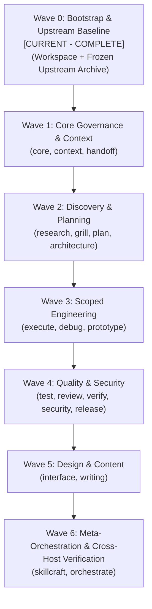

# Veyra v1.0 — Planning Baseline & Dependency-Driven Waves

> **Status:** INTEGRATED CANONICAL BASELINE
> **Authority:** Canonical Owner Decisions DEC-01 through DEC-35 (LOCKED)
> **Execution Strategy:** 7 Dependency-Driven Waves (DEC-09) with Strict Superiority Gates (DEC-10)

---

## 1. Wave Architecture & Gating Structure

Implementation is phased into 7 dependency-driven waves. Each wave forms an independently reviewable milestone:

## 2. Wave Milestone Breakdown

### Wave 0: Workspace Bootstrap & Upstream Provenance (Current Milestone)
- **Scope:** Canonical Owner Decisions lock (DEC-01..35), template v4.0 lean initialization, upstream baseline freeze (21 repos pinned), dual-layer provenance verification (archive SHA-256 vs git tree), preflight & continue driver.
- **Exit Gate:** 100% manifest SHA-256 match; all 35 canonical decisions locked; workspace continuation validated; Owner review.

### Wave 1: Core Governance & Context (Status: GATED / WAITING_FOR_OWNER_GO)
- **Skills:** `veyra-core`, `veyra-context`, `veyra-handoff`
- **Scope:** Intent-based skill discovery (DEC-21), lightweight portable checkpoint (DEC-24), risk-based stop & self-recovery (DEC-25).
- **Exit Gate:** Context preservation across simulated compaction; deterministic checkpoint recovery.

### Wave 2: Discovery & Planning (Status: PLANNED)
- **Skills:** `veyra-research`, `veyra-grill`, `veyra-plan`, `veyra-architecture`
- **Scope:** Primary-source retrieval, question-frontier interview stress testing, reviewable phased plans, modular seams.
- **Exit Gate:** Automated grill trace validation; dependency acyclicity tests.

### Wave 3: Scoped Engineering (Status: PLANNED)
- **Skills:** `veyra-execute`, `veyra-debug`, `veyra-prototype`
- **Scope:** Smallest-correct-change implementation, failure reproduction, throwaway prototypes.
- **Exit Gate:** Minimal diff validation; regression protection.

### Wave 4: Quality, Verification & Security (Status: PLANNED)
- **Skills:** `veyra-test`, `veyra-review`, `veyra-verify`, `veyra-security`, `veyra-release`
- **Scope:** Automated testing, dual-axis review, empirical evidence receipts, advisory security audit (DEC-31), SemVer + migration checks (DEC-33).
- **Exit Gate:** Independent Codex review pass; zero unhandled security vulnerabilities.

### Wave 5: Design & Content (Status: PLANNED)
- **Skills:** `veyra-interface`, `veyra-writing`
- **Scope:** Editorial UI craft, WCAG 2.2 contrast validation, anti-slop copy filter.
- **Exit Gate:** Automated accessibility pass; zero generic AI marketing tropes.

### Wave 6: Meta-Orchestration & Cross-Host Parity (Status: PLANNED)
- **Skills:** `veyra-skillcraft`, `veyra-orchestrate`
- **Scope:** Skill lifecycle authoring, native collaboration and optional governor (DEC-22), transparent sequential fallback (DEC-23), full matrix validation on Gemini, Codex, and Claude (DEC-34, DEC-35).
- **Exit Gate:** Full test matrix pass on all 3 hosts; final Stable release sign-off (DEC-32).
