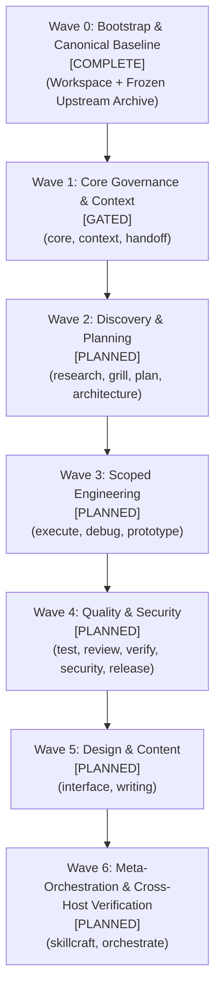

# Veyra v1.0 — Implementation Roadmap (Dependency-Driven Waves)

> Historical milestone plan. For current release evidence, consult qualification/RELEASE-GATE-DECISION.md.

> **Execution Strategy:** Implementation follows 7 dependency-driven waves (DEC-09). Each wave forms an independently reviewable milestone with strict superiority and verification criteria.
> **Current Status:** Wave 0 Complete (Canonical Reconciliation & Baseline Freeze).
> **Wave Governance:** Skill implementation (Waves 1 through 6) remains strictly gated until Owner GO is received.

---

---

## Wave Breakdown & Milestone Gates

### Wave 0: Workspace Bootstrap & Canonical Baseline (Status: `COMPLETE`)
- **Scope:** 35 Canonical Owner Decisions locked (DEC-01..35); integrated Developer Brief and Planning Baseline; 21 upstreams pinned in lockfile and local archive hash reported; pinned source commit identity and manifest contents NOT independently verified; preflight & continuation drivers validated.
- **Exit Gate:** All 35 canonical decisions locked; local archive checksum reported; source provenance remains release-gated; portable checkpoint verified; Owner review.

### Wave 1: Core Governance & Context (Status: `GATED / WAITING_FOR_OWNER_GO`)
- **Skills:** `veyra-core`, `veyra-context`, `veyra-handoff`
- **Scope:** Native intent discovery (DEC-21), lightweight portable checkpointing (DEC-24), risk-based stop & self-recovery (DEC-25).
- **Exit Gate:** Context preservation across simulated compaction; deterministic checkpoint resumption.

### Wave 2: Discovery & Planning (Status: `PLANNED`)
- **Skills:** `veyra-research`, `veyra-grill`, `veyra-plan`, `veyra-architecture`
- **Scope:** Bounded retrieval, question-frontier interview stress testing, reviewable phased plans, modular seams.
- **Exit Gate:** Automated grill trace validation; dependency acyclicity tests.

### Wave 3: Scoped Engineering (Status: `PLANNED`)
- **Skills:** `veyra-execute`, `veyra-debug`, `veyra-prototype`
- **Scope:** Smallest-correct-change implementation, root-cause isolation, throwaway prototypes.
- **Exit Gate:** Minimal diff validation; regression protection.

### Wave 4: Quality, Verification & Security (Status: `PLANNED`)
- **Skills:** `veyra-test`, `veyra-review`, `veyra-verify`, `veyra-security`, `veyra-release`
- **Scope:** Automated test execution, dual-axis review, empirical verification receipts, Advisory Security Gate (DEC-31), SemVer + migration checks (DEC-33).
- **Exit Gate:** Independent Codex review pass; zero unhandled security vulnerabilities.

### Wave 5: Design & Content (Status: `PLANNED`)
- **Skills:** `veyra-interface`, `veyra-writing`
- **Scope:** Editorial UI craft, WCAG 2.2 contrast checking, anti-slop copy filter.
- **Exit Gate:** Automated accessibility pass; zero generic AI marketing tropes.

### Wave 6: Meta-Orchestration & Cross-Host Verification (Status: `PLANNED`)
- **Skills:** `veyra-skillcraft`, `veyra-orchestrate`
- **Scope:** Skill lifecycle authoring, native collaboration with optional governor (DEC-22), transparent sequential fallback (DEC-23), full matrix validation on Gemini, Codex, and Claude (DEC-17, DEC-34, DEC-35).
- **Exit Gate:** Full test matrix pass on all 3 target hosts; Stable release sign-off (DEC-32).
