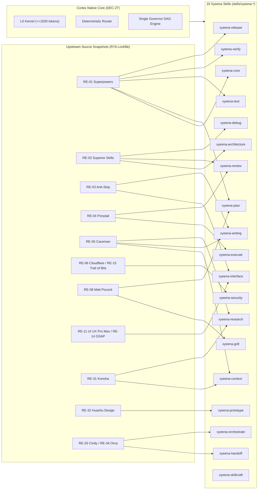

# Upstream Source Provenance & Behavioral Parity Ledger (R7A)

**Specification:** R7A — Reproducible Upstream Source Library  
**Lockfile Authority:** [`references/upstreams.lock.json`](../../references/upstreams.lock.json)  
**Storage Location:** `references/sources/` (excluded from Git and npm packaging by default)  
**Fetch & Verification Tooling:** [`scripts/fetch-upstream-sources.mjs`](../../scripts/fetch-upstream-sources.mjs)  
**Governance:** DEC-01 through DEC-32. Codex independently verifies provenance and source mapping before approving skill contracts at Gate 1 (G1).

---

## 1. Governance Principles & Epistemic Constraints

1. **Immutable Snapshot Prerequisite:** Before adapting or benchmarking any upstream capability, acquire an immutable source snapshot pinned at a verified commit SHA in `references/upstreams.lock.json`. Unpinned references (`HEAD` or floating tags) are strictly flagged as `PROVENANCE_PENDING`.
2. **Deep Source Inspection Rule:** An upstream is marked `SOURCE_INSPECTED` only after its original `SKILL.md` files, references, scripts, datasets, implementation, and relevant tests have been examined on disk. README-only research is strictly insufficient.
3. **No Silent Vendoring:** Preserving original licenses, copyrights, and notices is mandatory. Do not silently vendor or copy third-party source code into Xyeena. Adaptation must be architectural and clean-room or explicit direct reuse with complete license attribution in `NOTICE.md`.
4. **Behavioral Parity Standard:** File presence, static mappings, and source inspection alone never establish parity. Behavioral parity requires executable, evidence-based comparative evaluation under identical inputs and criteria against the pinned upstream snapshot.
5. **Fail-Closed Limitation Accounting:** If an upstream cannot be fetched, cloned, or executed (e.g. offline environment, missing runtime binary, unpinned SHA), record the limitation explicitly (`BLOCKED_OFFLINE` / `PROVENANCE_PENDING`). Never substitute generated content or synthetic passes for real upstream behavior.
6. **Codex G1 Verification Gate:** Codex independently audits and verifies the provenance records, file hashes, and source-to-skill mappings before any skill contract is approved for v1 release.

---

## 2. Upstream Source Inventory & Verification Status

| RE ID | Canonical Upstream Repository | Pinned Commit SHA / Release | License | Verification Status | Target Xyeena Skill(s) | Native Implementation Seam |
| :--- | :--- | :--- | :--- | :--- | :--- | :--- |
| **RE-01** | `https://github.com/obra/superpowers.git` | `2ce8aa15d05bd57213e6f746f953aafb7ded7a8b` (v7.0.1) | MIT | `SOURCE_INSPECTED` | `xyeena-core`, `xyeena-plan`, `xyeena-execute`, `xyeena-test`, `xyeena-debug`, `xyeena-verify`, `xyeena-release`, `xyeena-orchestrate`, `xyeena-review` | `src/methods/thinking.mjs`, `src/methods/engineering.mjs`, `src/core/composites.mjs` |
| **RE-02** | `https://github.com/KodekaTeam/superior-skills.git` | `3735e084d4ab310605bd945b53c674c87d2d7dbf` | MIT | `SOURCE_INSPECTED` | `xyeena-architecture`, `xyeena-review`, `xyeena-debug` | `src/methods/engineering.mjs` (`evaluateModuleSeam`, `dualAxisReview`) |
| **RE-03** | `https://github.com/miqdadbadjuber/anti-slop.git` | `b1cdf87d49b1653293d58424516fd80394008345` | MIT | `SOURCE_INSPECTED` | `xyeena-interface`, `xyeena-writing` | `src/methods/quality.mjs` (`auditUniversalAntiSlop`, `auditVisualAntiSlop`) |
| **RE-04** | `https://github.com/DietrichGebert/ponytail.git` | `96608e078b2d5ea607c5c3b8b5a54d1c1fba6846` | MIT | `SOURCE_INSPECTED` | `xyeena-execute`, `xyeena-review` | `src/methods/engineering.mjs` (`auditPonytailLeanDiff`) |
| **RE-05** | `https://github.com/JuliusBrussee/caveman.git` | `b4ee71d557d96e3cbc14f88fa6e953a1362865f5` | Apache-2.0 / MIT | `SOURCE_INSPECTED` | `xyeena-context`, `xyeena-writing`, `xyeena-verify`, `xyeena-research` | `src/methods/engineering.mjs` (`compressTechnicalOutput`, `verifyAndStop`) |
| **RE-06** | `https://github.com/cloudflare/security-audit-skill.git` | `c1c8a8c1471069fb0e188eeaff69b8e8db6564a8` | MIT | `SOURCE_INSPECTED` | `xyeena-security` | `src/methods/security.mjs` (`validateSecurityInvariant`) |
| **RE-07** | `https://github.com/pbakaus/impeccable.git` | *Unpinned host reference* | Apache-2.0 | `PROVENANCE_PENDING` | `xyeena-interface` | `src/methods/design.mjs` (`resolveSurfaceMode`, `critiqueCraft`) |
| **RE-08** | `https://github.com/mattpocock/skills.git` | `5863806dd4e15c63174bee4e7515a4256792ecfa` | MIT | `SOURCE_INSPECTED` | `xyeena-grill`, `xyeena-plan` | `src/methods/engineering.mjs` (`grillFrontier`, `synthesizeTechnicalSpec`) |
| **RE-09** | `https://github.com/togethercomputer/hallmark.git` | *Unpinned host reference* | MIT | `PROVENANCE_PENDING` | `xyeena-interface` | `src/methods/design.mjs` (`auditHallmarkFloor`) |
| **RE-10** | `https://github.com/Leonxlnx/taste-skill.git` | *Unpinned host reference* | MIT | `PROVENANCE_PENDING` | `xyeena-interface` | `src/methods/design.mjs` (`auditAppScreenCraft`) |
| **RE-11** | `https://github.com/nextlevelbuilder/ui-ux-pro-max.git` | *Unpinned host reference* | MIT | `PROVENANCE_PENDING` | `xyeena-interface` | `src/methods/design.mjs` (`validateTokenArchitecture`, `calculateWcagContrast`) |
| **RE-12** | `https://github.com/anthropics/skills.git` | *Tagged releases* | MIT / Source-Avail | `PROVENANCE_PENDING` | `xyeena-skillcraft` | `src/validate.mjs`, `src/methods/extensibility.mjs` |
| **RE-14** | `https://github.com/greensock/gsap-skills.git` | `aed9cfd3277740755f6bfc1155c7aa645403b760` | MIT / Web License | `SOURCE_INSPECTED` | `xyeena-interface` | `src/methods/design.mjs` (`auditMotionPerformance`, `verifyMotionLifecycleCleanup`) |
| **RE-15** | `https://github.com/trailofbits/skills.git` | `149d7b21f4067765b82e67029730b42d228ef4b4` | CC-BY-SA-4.0 | `SOURCE_INSPECTED` | `xyeena-security` | `src/methods/security.mjs` (`auditWorkflowSecurity`) |
| **RE-16** | `https://github.com/supabase/agent-skills.git` | `c9be0e931b7930f7d02126d04774d904c381e7d7` | MIT | `SOURCE_INSPECTED` | `xyeena-security` | `src/methods/security.mjs` (`evaluateRlsPolicy`, `detectServiceRoleKeyExposure`) |
| **RE-31** | `https://github.com/andycungkrinx91/konoha.git` | `9789bdd1d57d5f7a39a58406105e36127ffdb35b` | Apache-2.0 | `SOURCE_INSPECTED` | `xyeena-context`, `xyeena-research` | `src/methods/knowledge.mjs` (`boundedRetrieve`, `verifyTaskMemoryIsolation`) |
| **RE-32** | `https://github.com/alchaincyf/huashu-design.git` | `e8d1148a80d5a281d4247cffe320add3df017928` (v3.3.0) | MIT | `SOURCE_INSPECTED` | `xyeena-prototype` | `src/methods/design.mjs` (`exploreVisualDirections`, `generateInteractivePrototype`) |
| **RE-33** | `https://github.com/makecindy/cindy.git` | `15e197fbbe687e81b392ea42f5a8a360404dd3ad` | Apache-2.0 | `SOURCE_INSPECTED` | `xyeena-handoff`, `xyeena-context` | `src/methods/coordination.mjs` (`sessionContextHandoff`) |
| **RE-34** | `https://github.com/Aniekanetim/orca-agent.git` | `027acb4efa2e6b226d40df266b86367423946d62` | MIT | `SOURCE_INSPECTED` | `xyeena-orchestrate` | `src/task-graph.mjs`, `src/methods/coordination.mjs` |

---

## 3. Exact Source-to-Skill Mapping Matrix (All 19 Xyeena Skills)

Every skill in the Xyeena catalog binds to specific inspected upstream patterns while maintaining the single-governor Cortex invariant:

### Detailed Mapping Ledger

1. **`skills/xyeena-core/` (L0 Kernel)**
   - *Upstream:* RE-01 (Superpowers discipline), RE-20 (Xyeena Rig Kernel).
   - *Source Files Examined:* `superpowers/skills/using-superpowers/SKILL.md`, `superpowers/skills/verification-before-completion/SKILL.md`.
   - *Native Binding:* `src/core/kernel.mjs`, `src/core/router.mjs`.
   - *Delta & Invariants:* Retains evidence-before-claim and four operating disciplines. Enforces invariant L0 budget ($\le$ 1,500 tokens); micro-tasks resolve directly without DAG overhead (< 5ms per DEC-27).

2. **`skills/xyeena-architecture/`**
   - *Upstream:* RE-02 (Superior Skills).
   - *Source Files Examined:* `superior-skills/skills/codebase-design/SKILL.md`, `superior-skills/skills/domain-modeling/SKILL.md`.
   - *Native Binding:* `src/methods/engineering.mjs` (`evaluateModuleSeam`, `evaluateArchitectureBoundaries`).
   - *Delta & Invariants:* Quantitative seam evaluation (internal LOC to exposed methods ratio $\ge$ 15 indicates deep module; shallow wrappers rejected).

3. **`skills/xyeena-context/`**
   - *Upstream:* RE-05 (Caveman context economy), RE-31 (Konoha memory isolation), RE-33 (Cindy context handoff).
   - *Source Files Examined:* `caveman/skills/caveman-compress/SKILL.md`, `konoha/src/memory/`.
   - *Native Binding:* `src/runtime/compaction.mjs`, `src/runtime/memory.mjs`, `src/methods/knowledge.mjs`.
   - *Delta & Invariants:* Replaces foreign background database daemons with in-memory task-scoped isolation and deterministic checkpoint recovery.

4. **`skills/xyeena-debug/`**
   - *Upstream:* RE-01 (Superpowers systematic debugging), RE-02 (Superior root-cause analysis).
   - *Source Files Examined:* `superpowers/skills/systematic-debugging/SKILL.md`, `superpowers/skills/diagnosing-bugs/SKILL.md`.
   - *Native Binding:* `src/methods/engineering.mjs` (`traceRootCause5Whys`), `src/task-runner.mjs`.
   - *Delta & Invariants:* Rejects superficial single-layer fixes; requires systematic 5-whys tracing (depth $\ge$ 3) and executable reproduction before applying minimal patch.

5. **`skills/xyeena-execute/`**
   - *Upstream:* RE-01 (Superpowers executing-plans), RE-04 (Ponytail smallest-correct-change).
   - *Source Files Examined:* `superpowers/skills/executing-plans/SKILL.md`, `ponytail/skills/ponytail/SKILL.md`.
   - *Native Binding:* `src/methods/engineering.mjs` (`auditPonytailLeanDiff`), `src/task-runner.mjs`.
   - *Delta & Invariants:* Strict scope boundary lock. Forbids opportunistic refactoring ("while I'm here"); verifies lean diffs against authorized task specifications.

6. **`skills/xyeena-grill/`**
   - *Upstream:* RE-08 (Matt Pocock question-frontier grilling).
   - *Source Files Examined:* `mattpocock/skills/grilling/SKILL.md`.
   - *Native Binding:* `src/methods/engineering.mjs` (`grillFrontier`), `src/methods/thinking.mjs`.
   - *Delta & Invariants:* Interactive frontier stress-testing. Discussion mode only; strictly modifies zero files during interrogation.

7. **`skills/xyeena-handoff/`**
   - *Upstream:* RE-33 (Cindy multi-harness session handoff).
   - *Source Files Examined:* `cindy/src/session/handoff.ts`.
   - *Native Binding:* `src/methods/coordination.mjs` (`sessionContextHandoff`), `src/runtime/checkpoint.mjs`.
   - *Delta & Invariants:* Generates compact session transition ledgers without embedding proprietary desktop daemons.

8. **`skills/xyeena-interface/`**
   - *Upstream:* RE-03 (Anti-Slop), RE-07 (Impeccable), RE-09 (Hallmark), RE-10 (Taste), RE-11 (UI UX Pro Max), RE-14 (GSAP).
   - *Source Files Examined:* `anti-slop/skills/antislop-ui/SKILL.md`, `gsap-skills/skills/gsap-performance/SKILL.md`.
   - *Native Binding:* `src/methods/design.mjs` (`validateTokenArchitecture`, `calculateWcagContrast`, `auditHallmarkFloor`, `auditMotionPerformance`).
   - *Delta & Invariants:* 3-tier token hierarchy validation (primitive $\to$ semantic $\to$ component), WCAG 2.2 AA/AAA mathematical contrast calculation, touch targets $\ge$ 24px/44px, compositor transform verification.

9. **`skills/xyeena-orchestrate/`**
   - *Upstream:* RE-01 (Superpowers parallel agents), RE-34 (Orca Run/Task/Dispatch lifecycle), RE-20 (Cortex DAG).
   - *Source Files Examined:* `superpowers/skills/dispatching-parallel-agents/SKILL.md`, `orca-agent/src/supervisor/`.
   - *Native Binding:* `src/task-graph.mjs`, `src/core/cortex.mjs`, `src/methods/coordination.mjs`.
   - *Delta & Invariants:* Manager-controlled DAG; topological sorting with cycle detection. Enforces maker-checker separation (author $\neq$ reviewer); rejects unmanaged subagent meshes.

10. **`skills/xyeena-plan/`**
    - *Upstream:* RE-01 (Superpowers writing-plans), RE-08 (Matt Pocock to-tickets tracer bullets).
    - *Source Files Examined:* `superpowers/skills/writing-plans/SKILL.md`, `mattpocock/skills/tracer-bullets/SKILL.md`.
    - *Native Binding:* `src/methods/engineering.mjs` (`synthesizeTechnicalSpec`, `breakdownTracerBulletTickets`), `src/task-graph.mjs`.
    - *Delta & Invariants:* Decomposes multi-step tasks into reviewable DAG phases with explicit verification commands and rollback criteria.

11. **`skills/xyeena-prototype/`**
    - *Upstream:* RE-01 (Superpowers prototype), RE-32 (Huashu Design 3 visual directions).
    - *Source Files Examined:* `superpowers/skills/prototype/SKILL.md`, `huashu-design/skills/prototype/SKILL.md`.
    - *Native Binding:* `src/methods/design.mjs` (`exploreVisualDirections`, `generateInteractivePrototype`).
    - *Delta & Invariants:* Bounded disposable experiments with falsifiable hypotheses; strict quarantine from production code surfaces.

12. **`skills/xyeena-release/`**
    - *Upstream:* RE-01 (Superpowers finishing-a-development-branch), RE-20 (Xyeena release gate).
    - *Source Files Examined:* `superpowers/skills/finishing-a-development-branch/SKILL.md`.
    - *Native Binding:* `src/methods/engineering.mjs` (`evaluateReleaseReadiness`), `src/methods/delivery.mjs`.
    - *Delta & Invariants:* Gates G1 through G4 verification; rollback verification; zero premature release claims while host gates remain unfulfilled.

13. **`skills/xyeena-research/`**
    - *Upstream:* RE-05 (Caveman grounded citation), RE-31 (Konoha bounded retrieval).
    - *Source Files Examined:* `caveman/skills/caveman-explore/SKILL.md`, `konoha/src/retrieval/`.
    - *Native Binding:* `src/methods/knowledge.mjs` (`boundedRetrieve`).
    - *Delta & Invariants:* High-trust primary-source grounding with byte and result bounds; path boundary containment.

14. **`skills/xyeena-review/`**
    - *Upstream:* RE-01 (Superpowers receiving-code-review), RE-02 (Superior dual-axis review), RE-04 (Ponytail lean review).
    - *Source Files Examined:* `superpowers/skills/receiving-code-review/SKILL.md`, `superior-skills/skills/code-review/SKILL.md`.
    - *Native Binding:* `src/methods/engineering.mjs` (`dualAxisReview`, `receiveReviewFeedback`).
    - *Delta & Invariants:* Separates standards compliance from spec satisfaction; rejects performative agreement; requires evidence-grounded response before code edits.

15. **`skills/xyeena-security/`**
    - *Upstream:* RE-06 (Cloudflare security finding schema), RE-15 (Trail of Bits workflow security), RE-16 (Supabase RLS evaluation).
    - *Source Files Examined:* `security-audit-skill/SKILL.md`, `supabase/agent-skills/skills/database/SKILL.md`.
    - *Native Binding:* `src/methods/security.mjs` (`validateSecurityInvariant`, `auditWorkflowSecurity`, `evaluateRlsPolicy`, `detectServiceRoleKeyExposure`).
    - *Delta & Invariants:* Scoped security review by default; machine-readable findings; service-role key exposure and transactional PostgreSQL migration lock checks.

16. **`skills/xyeena-skillcraft/`**
    - *Upstream:* RE-01 (Superpowers writing-skills), RE-12 (Anthropic standard skills conventions).
    - *Source Files Examined:* `superpowers/skills/writing-skills/SKILL.md`.
    - *Native Binding:* `src/validate.mjs`, `src/methods/extensibility.mjs`.
    - *Delta & Invariants:* YAML frontmatter validation, lean manifest discipline (no bloated unused fields), explicit procedure linkage.

17. **`skills/xyeena-test/`**
    - *Upstream:* RE-01 (Superpowers test-driven-development), RE-20 (Xyeena TDD engine).
    - *Source Files Examined:* `superpowers/skills/test-driven-development/SKILL.md`.
    - *Native Binding:* `src/methods/engineering.mjs` (`verifyTddCycle`, `formulateTestStrategy`).
    - *Delta & Invariants:* Enforces strict Red-Green-Refactor test pyramid discipline with test isolation and independent verification.

18. **`skills/xyeena-verify/`**
    - *Upstream:* RE-01 (Superpowers verification-before-completion), RE-05 (Caveman verify-and-stop).
    - *Source Files Examined:* `superpowers/skills/verification-before-completion/SKILL.md`, `caveman/skills/verify-and-stop/SKILL.md`.
    - *Native Binding:* `src/methods/engineering.mjs` (`verifyAndStop`), `src/methods/quality.mjs`.
    - *Delta & Invariants:* Enforces evidence before assertion; requires fresh executable evidence before any success claim.

19. **`skills/xyeena-writing/`**
    - *Upstream:* RE-03 (Anti-Slop copywriting cliches), RE-05 (Caveman technical output compression).
    - *Source Files Examined:* `anti-slop/skills/antislop-copywriting/SKILL.md`, `caveman/skills/caveman-commit/SKILL.md`.
    - *Native Binding:* `src/methods/quality.mjs` (`auditUniversalAntiSlop`), `src/methods/engineering.mjs` (`compressTechnicalOutput`).
    - *Delta & Invariants:* Eliminates AI fluff and corporate clichés; enforces active voice, evidence grounding, and concise human prose.

---

## 4. Verification and Packaging Exclusion Proof

To satisfy R7A packaging isolation requirements:
1. **Git Isolation:** `references/sources/` is registered in [`.gitignore`](../../.gitignore).
2. **Package Isolation:** `references/` is omitted from the `package.json` `"files"` whitelist, ensuring zero source snapshots leak into the published npm distribution.
3. **Reproducibility Test:** [`test/upstream-provenance.test.mjs`](../../test/upstream-provenance.test.mjs) executes in CI, asserting lockfile validity, exclusion rules, and failure containment.
