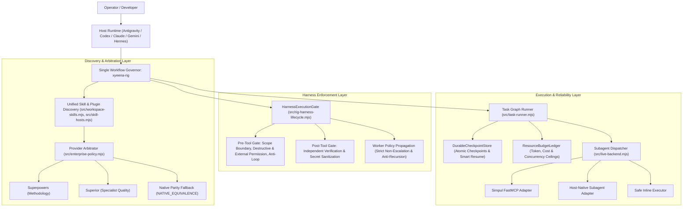

# Architecture — Enterprise Xyeena Rig

**Current Verified Baseline:** `0.4.1`  
**Target Release Candidate:** `0.5.0`  
**Governing Component:** `xyeena-rig`  

---

## 1. System Overview & Layer Architecture

---

## 2. Core Architectural Pillars

### A. Single Workflow Governor
- `xyeena-rig` retains absolute controller authority over workflow state, task graphs, permission gates, and verification claims.
- Superpowers supplies compatible software-development methodologies (`using-git-worktrees`, `writing-plans`, `subagent-driven-development`).
- Superior supplies specialized engineering quality capabilities (`superior-logic`, `superior-code-review`, `superior-testing`).
- If either external provider is absent, untrusted, disabled, or fails mid-run, Xyeena Native automatically takes over with zero disruption (`NATIVE_EQUIVALENCE`).

### B. Executable Harness Enforcement
- Replaces passive declarative guidance with an active execution boundary via `HarnessExecutionGate`.
- **Pre-Tool Gate:**
  - Lexical and physical workspace boundary containment (`assertWorkspaceBoundary`).
  - Null-byte path injection protection (`\0`).
  - Destructive operations (`rm -rf`, `reset --hard`) blocked with `DENY` or interactive `ANSWER_QUESTION`.
  - External operations (`git push`, `npm publish`) require explicit authorization or single-use `ALLOW_ONCE` tokens.
  - Anti-loop detector halts after 3 consecutive identical tool failures.
- **Post-Tool Gate:**
  - Self-certified model completion (`status: PASS`) without independent verifier proof is marked invalid.
  - Secret credentials (PATs, API keys, private keys, Bearer tokens) are redacted from all audit entries.
- **Worker Policy Propagation:**
  - Child workers inherit only a subset of parent permissions (`parent && delegated`).
  - Strict anti-recursion guard prevents workers at depth >= 1 from creating nested sub-workers (`noNestedDelegation`).

### C. Live Backend Dispatching & Resource Budgets
- **Simpul FastMCP Contract:**
  - Connects to `SubagentBridge` over FastMCP transport (`submit_goal`, `get_task_evidence`, `get_model_usage`, `cancel_run`).
  - Probes health and non-nested execution boundaries before dispatch.
- **Host-Native Subagents:**
  - Dispatches isolated workers with real worker IDs and clean abort signal propagation.
- **Resource Budget Ledger:**
  - Tracks token count, micro-dollar cost, and concurrency ceilings per orchestration run.
  - Serializes unisolated writes to avoid race conditions and file collisions.

### D. Durable Checkpoints & Crash Recovery
- Task DAG checkpoints are atomically saved to `.xyeena/runs/<runId>/dag-checkpoint.json` on every state transition.
- **Smart Resume Suggestion:** Formats structured human-readable recommendations showing completed tasks, pending work, and exact continuation commands.
- **Unconsumed Worker Result Reclaiming:** If an orchestrator process is killed after a worker completes, the runner recovers the worker's evidence artifact from disk without re-dispatching.
- **Anti-Loop Review Cycle Breaker:** Bounded review/repair iterations terminate oscillating reviews after 3 cycles, marking the task `BLOCKED` with actionable remediation.

### E. Compact Single-Root Installer Layout
- Host-visible layout: exposes one single root skill: `<skills-root>/xyeena-rig/SKILL.md`.
- All 19 native Xyeena modules are organized as internal reference documents under `references/skills/xyeena-*/SKILL.md`.
- **Legacy Migration & Compatibility:**
  - `resolveSkillAlias`: automatically maps legacy slash commands (`/xyeena-orchestrate`, `/xyeena-debug`) to their compact reference file.
  - Ownership-aware migration checks `.xyeena-managed.json` markers and SHA-256 byte fingerprints.
  - User notes, modified skills, and third-party skills are strictly preserved in place.
  - Timestamped backups and `rollback.json` journals ensure atomic rollback to original flat layouts if desired.
