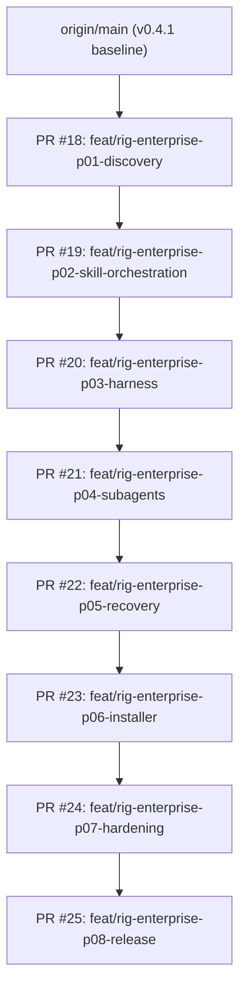

# Xyeena Rig — Sequential Stacked PR Index & Dependency Graph

**Baseline Baseline:** `origin/main` (commit `4f0fa5e`, `v0.4.1`)  
**Strategy:** Worktree-isolated, strictly stacked sequential feature PR chain.  
**Execution Owner:** Xyeena Rig.  

---

## 1. Stacked PR Dependency Chain



---

## 2. Sequential Phase Registry

| Phase | Branch | PR URL | Target Base | Commit SHA | Scope / Requirements | Status |
| --- | --- | --- | --- | --- | --- | --- |
| **P01** | `feat/rig-enterprise-p01-discovery` | [PR #18](https://github.com/rzqllh/xyeena/pull/18) | `main` | `eb57905` | R01, R02: Unified skill discovery, plugin enumeration, provenance, collision precedence, dependency closure | **CI_PASS** |
| **P02** | `feat/rig-enterprise-p02-skill-orchestration` | [PR #19](https://github.com/rzqllh/xyeena/pull/19) | P01 (`feat/rig-enterprise-p01-discovery`) | `61b4fc2` | R03, R04: Superpowers & Superior arbitration, single governor (`xyeena-rig`), native parity fallback | **CI_PASS** |
| **P03** | `feat/rig-enterprise-p03-harness` | [PR #20](https://github.com/rzqllh/xyeena/pull/20) | P02 (`feat/rig-enterprise-p02-skill-orchestration`) | `67d9282` | R05, R10: Automatic Harness enforcement, `HarnessExecutionGate`, workspace containment, non-escalation | **CI_PASS** |
| **P04** | `feat/rig-enterprise-p04-subagents` | [PR #21](https://github.com/rzqllh/xyeena/pull/21) | P03 (`feat/rig-enterprise-p03-harness`) | `d530e5c` | R06, R07, R08: Simpul MCP adapter contract, native subagent adapter, `ResourceBudgetLedger`, fallback priority | **INTEGRATION_VERIFIED; LIVE_BLOCKED** |
| **P05** | `feat/rig-enterprise-p05-recovery` | [PR #22](https://github.com/rzqllh/xyeena/pull/22) | P04 (`feat/rig-enterprise-p04-subagents`) | `42e4e6d` | R08, R09, R10: `DurableCheckpointStore`, smart resume, unconsumed result recovery, anti-loop breaker | **CI_PASS** |
| **P06** | `feat/rig-enterprise-p06-installer` | [PR #23](https://github.com/rzqllh/xyeena/pull/23) | P05 (`feat/rig-enterprise-p05-recovery`) | `45bc486` | R11, R12: Compact installer lifecycle, 19-skill migration, ownership verification, rollback journal, safe uninstaller | **CI_PASS** |
| **P07** | `feat/rig-enterprise-p07-hardening` | [PR #24](https://github.com/rzqllh/xyeena/pull/24) | P06 (`feat/rig-enterprise-p06-installer`) | `4e3cf0e` | R13, R14: Adversarial hardening, null-byte path defense, secret sanitization, anti-recursion guard, 5-runtime fixtures | **FIXTURE_PASS; LIVE_BLOCKED** |
| **P08** | `feat/rig-enterprise-p08-release` | [PR #25](https://github.com/rzqllh/xyeena/pull/25) | P07 (`feat/rig-enterprise-p07-hardening`) | `HEAD` | R15: Enterprise release candidate, documentation sync, package verification, independent QA verdict | **CONDITIONAL_GO** |

---

## 3. Merge Procedure for Operator

To merge the enterprise stack cleanly into `main`:
1. Review and merge **PR #18** into `main`.
2. Retarget **PR #19** to `main` (or merge sequentially into predecessor branch).
3. Repeat sequentially through **PR #25**.
4. Run full post-merge verification on `main`:
   ```bash
   npm ci
   npm test
   npm run check
   npm run eval
   npm run test:harness
   npm run test:consumer
   npm pack --dry-run
   ```
5. Authorize release tagging and npm publication for `0.5.0`.
